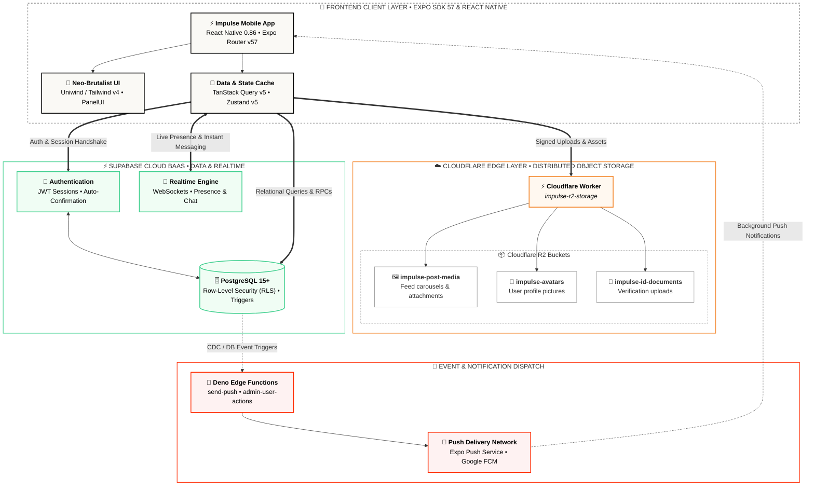
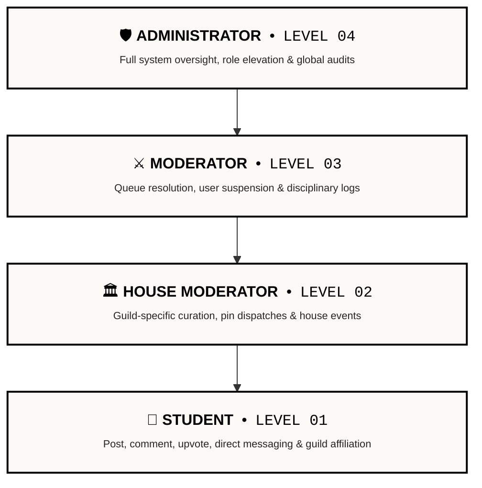

<!--
  IMPULSE — THE ITE DEPARTMENT STUDENT NETWORK
  Designed with a Neo-Brutalist / Cyber-Industrial aesthetic.
-->

<div align="center">

<!-- COVER PHOTO / BANNER PLACEHOLDER -->
<!-- Drop your banner image into assets/banner.png or update the path below -->
<p align="center">
  
</p>

#  IMPULSE

**The Flagship Student Network for the Department of Information Technology Education (ITE)**

[](https://reactnative.dev)
[](https://expo.dev)
[](https://supabase.com)
[](https://cloudflare.com)
[](https://tailwindcss.com)
[](https://www.typescriptlang.org)
[](./LICENSE.md)

<p align="center">
  <strong>Built by Students, for Students</strong> • Bridging <strong>BSIT</strong> & <strong>BSCS</strong> students across technical disciplines, creative arts, and collegiate journalism.
</p>

<p align="center">
  <a href="#-overview">Overview</a> •
  <a href="#-key-features">Features</a> •
  <a href="#-the-guild-ecosystem">Guild Ecosystem</a> •
  <a href="#-system-architecture">Architecture</a> •
  <a href="#-technology-stack">Tech Stack</a> •
  <a href="#-getting-started">Getting Started</a> •
  <a href="#-security--role-hierarchy">Security & Roles</a> •
  <a href="#-development-standards">Quality & Tooling</a> •
  <a href="#-engineering-team">Credits</a>
</p>

---

</div>

<br/>

## 🌐 Overview

**Impulse** is an ultra-modern, high-performance departmental social and dispatch mobile application engineered specifically for the **Information Technology Education (ITE)** community.

Rather than generic campus chat groups, Impulse introduces a **gamified guild architecture**, **real-time peer messaging**, **academic dispatch bulletins**, and **developer-first technical discussions** wrapped in a distinctive **Neo-Brutalist & Cyber-Industrial** design language.

<div align="center">

| Specification | Details | Parameter | Details |
| :--- | :--- | :--- | :--- |
| 📡 **Sector** | `CAMPUS NETWORK` | 🟢 **Status** | `OPERATIONAL` |
| 🎯 **Target** | `BSIT & BSCS DEPT` | 🎨 **Aesthetic** | `NEO-BRUTALIST / CYBER` |
| 🔤 **Typography** | `Anton • Courier Prime • JetBrains` | ☁️ **Storage** | `Cloudflare R2 & Workers` |

</div>

### Why Impulse?
- 🧑‍💻 **Technical Discourse First**: Native terminal code viewports with syntax highlighting for sharing code snippets right in the departmental feed.
- 🏛️ **Disciplinary Guilds**: Students identify with their specialization houses (Developers, Creatives, and Media/Journalists).
- 📢 **Verified Dispatches**: Urgent announcements, department meetings, hackathons, and event schedules with RSVP & location coordinates.
- ⚡ **Low Latency, High Trust**: Supabase Realtime for instant messaging and presence indicators paired with strict PostgreSQL Row-Level Security (RLS).
- ☁️ **Zero Cloud Storage Bottlenecks**: High-speed, edge-cached media assets powered by Cloudflare Workers and Cloudflare R2 object storage.

---

## ✨ Key Features

| Category | Capability | Highlight |
|:---|:---|:---|
| 📰 **Interactive Feed** | Multi-media posts, markdown rendering, automated link previews, tag categorizations, and Karma voting. | Custom `TerminalCodeViewport` renders monospaced code blocks with syntax styling. |
| 🏛️ **Guild Ecosystem** | Three specialized houses for ITE majors to rally under, complete with custom house badges, manifestos, and feeds. | Real-time guild filters and house mod designations. |
| 📡 **Dispatches & Events** | Departmental official announcements with scheduled event start/end times and pinned venue coordinates. | Distinct visual badges for urgent bulletins and department releases. |
| 💬 **Real-time Messaging** | Encrypted peer-to-peer discussions, live typing indicators, and presence tracking. | Backed by Supabase Realtime Channels with offline sync and optimistic mutations. |
| 🛡️ **Role-Based Governance** | Fine-grained permission model (`user`, `house_mod`, `mod`, `admin`) to maintain academic integrity and decorum. | Integrated moderation queue, report logging, and disciplinary actions. |
| 🪪 **Verified Profiles** | Student profiles enriched with verified course (`BSIT` / `BSCS`), academic year (`1st` to `4th`), guild affiliation, and karma rating. | Private student profiles segregating academic email identity. |
| 🔔 **Push Notifications** | Background push alerts for mentions, comments, direct messages, and campus dispatches. | Supabase Edge Functions orchestrating Google FCM / Expo Push Service. |

---

## 🏛️ The Guild Ecosystem

Impulse organizes student collaboration into three thematic **Departmental Guilds**:

<div align="center">

| House | Symbol | Discipline / Sector | Manifesto & Mission |
|:---:|:---:|:---|:---|
| <br/><strong style="color:#BE0203">Octagram</strong> | `0x` | **Hardware, Software & Networking**<br/>*(Developers & Coders)* | *"Building ideas through code, creating solutions through technology, and connecting people through innovation."* |
| <br/><strong style="color:#0C7C28">Chameleon</strong> | `★` | **3D, GFX & Typography**<br/>*(GFX Artists & UI/UX)* | *"Bringing ideas to life through creative designs, colorful visuals, and engaging media."* |
| <br/><strong style="color:#00E5FF">Blue Jays</strong> | `BJ` | **Journalism & Media**<br/>*(Influencers & Communicators)* | *"Creating meaningful content, connecting people, and sharing stories that inspire."* |

</div>

Each guild features its own designated visual identity, brand accents, house moderators (`house_mod`), and filtered content channels.

---

## 🏗️ System Architecture

Impulse leverages a decoupled, edge-first architecture ensuring lightning-fast load times and strict data privacy:



---

## 💻 Technology Stack

Impulse is built with cutting-edge mobile and backend frameworks:

### Mobile Core & Framework
- **Runtime**: [React Native 0.86.3](https://reactnative.dev) + [React 19.2.3](https://react.dev)
- **Framework**: [Expo SDK ~57.0](https://expo.dev) with [Expo Router v57](https://docs.expo.dev/router/introduction/) (File-based navigation)
- **Styling & Design System**: [Uniwind](https://github.com) + [TailwindCSS v4.3](https://tailwindcss.com) + Custom Neo-Brutalist Tokens
- **Typography**: [Anton](https://fonts.google.com/specimen/Anton) (Headlines), [Courier Prime](https://fonts.google.com/specimen/Courier+Prime) (Body/Data), [JetBrains Mono](https://www.jetbrains.com/lp/mono/) (Code)
- **Animations & Gestures**: [React Native Reanimated v4.5](https://docs.swmansion.com/react-native-reanimated/) + [React Native Gesture Handler](https://docs.swmansion.com/react-native-gesture-handler/)
- **Data Fetching & Cache**: [TanStack React Query v5](https://tanstack.com/query/latest)
- **Local State Store**: [Zustand v5](https://github.com/pmndrs/zustand)
- **List Performance**: [@shopify/flash-list 2.0](https://shopify.github.io/flash-list/)
- **Icons**: [Lucide React Native](https://lucide.dev) & [Hugeicons](https://hugeicons.com)

### Backend & Cloud Infrastructure
- **Database & Auth**: [Supabase](https://supabase.com) (PostgreSQL 15+, Custom Triggers, Row Level Security)
- **Real-time Pipeline**: Supabase Realtime Channels (WebSockets for presence, typing status, and messaging)
- **Edge Media Storage**: [Cloudflare R2](https://www.cloudflare.com/developer-platform/r2/) orchestrated by [Cloudflare Workers](https://workers.cloudflare.com/) (`impulse-r2-storage`)
- **Serverless Compute**: Deno-powered Supabase Edge Functions (`send-push`, `send-message-push`, `admin-user-actions`)

### Developer Productivity & Code Health
- **Package Manager**: [Bun](https://bun.sh) (Blazing fast dependency resolution)
- **Linter & Formatter**: [Oxlint](https://oxc-project.github.io/) & [Oxfmt](https://oxc-project.github.io/) (Rust-based ultra-fast linting)
- **Git Hooks**: [Husky](https://typicode.github.io/husky/) + [Lint-Staged](https://github.com/lint-staged/lint-staged) + [Commitlint](https://commitlint.js.org/) (Conventional Commits)
- **Continuous Integration**: GitHub Actions + EAS Cloud Build (`eas.json`)

---

## 📁 Repository Structure

```text
impulse1/
├── app/                              # Expo Router application screens & navigation
│   ├── (auth)/                       # Authentication screens (Sign In, Sign Up)
│   ├── (onboarding)/                 # Department welcome & onboarding carousel
│   ├── (tabs)/                       # Main bottom-tab navigation
│   │   ├── index.tsx                 # Campus discussion feed & code viewports
│   │   ├── guilds.tsx                # Guild hubs (Octagram, Chameleon, Blue Jays)
│   │   ├── dispatch.tsx              # Department dispatches, events & bulletins
│   │   ├── messages.tsx              # Direct conversations inbox
│   │   ├── search.tsx                # Universal student & post discovery
│   │   └── profile.tsx               # Student bio, achievements & settings
│   ├── admin/                        # Department admin console & moderation triage
│   ├── legal/                        # Department privacy policy & terms of service
│   ├── messages/[id].tsx             # Live 1-on-1 realtime chat interface
│   ├── post/[id].tsx                 # Detailed thread view with replies & media
│   └── u/[username].tsx              # Public student portfolio view
├── assets/                           # Branding assets, guild SVGs, and app icons
├── src/
│   ├── components/ui/                # Neo-Brutalist design library (Cards, Buttons, Inputs)
│   ├── features/                     # Domain-driven feature modules
│   │   ├── admin/                    # Admin statistics and user management
│   │   ├── auth/                     # Session state, permission checks, role badges
│   │   ├── dispatch/                 # Dispatch cards, filters, and composer modal
│   │   ├── guilds/                   # Guild metadata, house constants, badge logic
│   │   ├── messages/                 # Chat API, message state, presence hooks
│   │   ├── moderation/               # Flagging, reports, bans, and actions
│   │   ├── notifications/            # In-app notification center & push listeners
│   │   ├── posts/                    # Post creation, media carousels, voting, code viewer
│   │   └── presence/                 # Real-time online/active status sync
│   ├── lib/                          # Core utilities (Supabase, R2 client, dates, queryClient)
│   └── theme/                        # Global styles, Uniwind configuration, font bindings
├── supabase/
│   ├── functions/                    # Serverless Deno Edge Functions
│   │   ├── admin-user-actions/       # Moderation & role escalation endpoints
│   │   ├── send-push/                # Notification dispatch handler
│   │   └── send-verification-email/  # Academic email verification
│   ├── migrations/                   # Timestamped schema evolutions
│   └── schema.sql                    # Master schema, triggers, and RLS definitions
└── workers/
    └── r2-storage/                   # Cloudflare Worker for high-throughput media I/O
```

---

## 🚀 Getting Started

### Prerequisites

Ensure you have the following installed on your development machine:
- **Node.js**: `v20.x` or higher
- **Bun**: `v1.3.x` or higher (`curl -fsSL https://bun.sh/install | bash`)
- **Expo CLI**: Included with `bunx expo`
- **Git**

### 1. Clone the Repository

```bash
git clone https://github.com/janleigh/impulse.git
cd impulse
```

### 2. Install Dependencies

Using `bun` (recommended for fastest install and lockfile alignment):

```bash
bun install
```

### 3. Configure Environment Variables

Create a local `.env` configuration file based on the provided template:

```bash
cp .env.example .env
```

Populate the required environment variables in your `.env` file according to your deployment configuration (see `.env.example`).


### 4. Run the Development Server

Start the Expo development server:

```bash
# Standard local development
bun dev

# Run with tunnel (for testing on physical mobile devices outside local network)
bun dev:tunnel

# Start directly for Android emulator
bun android

# Start directly for iOS simulator
bun ios
```

Press `a` for Android, `i` for iOS, or scan the QR code with **Expo Go** / development client.

### 5. Deploy Cloudflare R2 Worker (Optional)

To configure the media handling worker:

```bash
cd workers/r2-storage
bunx wrangler login
bunx wrangler deploy
```

---

## 🛡️ Security & Role Hierarchy

Impulse enforces a tiered academic governance model directly inside PostgreSQL using **Row-Level Security (RLS)**:



<div align="center">

| Role | Level | Privileges & Governance Scope |
| :--- | :---: | :--- |
| 🛡️ **Administrator** | `L4` | Full database oversight, role elevation/demotion, global audits, RLS bypass on administrative RPCs. |
| ⚔️ **Moderator** | `L3` | Queue resolution, user suspension, disciplinary audit logs, content redaction across all public feeds. |
| 🏛️ **House Moderator** | `L2` | Guild-specific content curation, pin dispatches, coordinate house events, and report house infractions. |
| 👤 **Student (Default)** | `L1` | Create posts, engage in discussions, upvote/downvote (karma), 1-on-1 realtime DMs, and join an ITE guild. |

</div>

- **Private Profile Segregation**: Student email addresses and verification metadata are stored in `private_profiles` with strict RLS prohibiting unauthorized student discovery.
- **Audited Administrative RPCs**: Modifying roles or banning accounts requires cryptographically signed tokens or execution through authenticated Edge Functions (`admin-user-actions`).
- **Encrypted Media Access**: Media uploaded to R2 utilizes signed tokens with rigorous file-type and payload size validation (`src/lib/media-validation.ts`).

---

## 🎨 Design Philosophy & Aesthetic

Impulse departs from cookie-cutter design templates by embracing a **Cyber-Industrial Neo-Brutalism**:

- **Hard-Edged Minimalism**: Zero corner radii (`--radius: 0px`) accented with heavy 2px/3px black borders (`#000000`).
- **High-Contrast Palette**: Cream/newsprint background (`#FAF9F5`), electric red accents (`#FF2A00`), and neon green terminal status lights (`#00FF66`).
- **Tactile Shadows**: Deep, unblurred drop-shadow offsets (`shadow-neo`, `shadow-neo-lg`) that mimic physical mechanical buttons.
- **Terminal Typography**: Blending bold, punchy display lettering (**Anton**) with precision monospace typefaces (**Courier Prime** and **JetBrains Mono**).

---

## 🧪 Development Standards

We adhere to rigorous code cleanliness and performance standards:

```bash
# Run ultra-fast Rust-based linter
bun run lint

# Auto-format codebase with Oxfmt
bun run fmt

# Run TypeScript typechecks
bunx tsc --noEmit

# Validate Expo dependency compatibility
bunx expo-doctor
```

Every commit is validated using **Husky** hooks running **Lint-Staged** and **Commitlint** with the Conventional Commits specification:
```text
feat(guilds): implement real-time house member counter
fix(messages): prevent duplicate optimistic chat bubbles
perf(feed): memoize terminal syntax highlighting tokens
```

---

## 👥 Engineering Team

Impulse is conceived, designed, and maintained by passionate ITE engineering students:

<div align="center">

| Avatar | Engineer | Role | Handles |
|:---:|:---|:---|:---|
|  | **Jan Leigh Muñoz** | **Lead Developer & Software Architect** | [@janleigh](https://github.com/janleigh) |

</div>

---

## 📄 License

This project is licensed under the **MIT License** — see the [LICENSE.md](./LICENSE.md) file for complete details.

<div align="center">

<sub> <b>IMPULSE</b> • DEPARTMENT OF INFORMATION TECHNOLOGY EDUCATION • BUILT WITH PASSION • 2026</sub>

</div>
